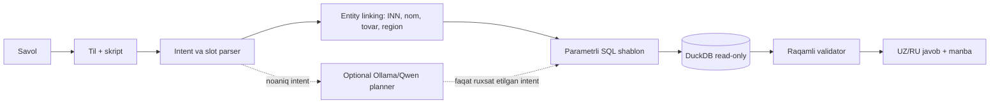

# UZEX AI Agent — yechim tavsifi

## 1. Muammo

Agent UZEX spot bitimlari haqidagi ruscha va o‘zbekcha savollarni lokal dataset asosida aniq hisoblab javob beradi. Dataset 2022-01-03 dan 2026-10-30 gacha bo‘lgan bitimlar, shartnomalar, qatnashchilar, brokerlar va USD kurslarini o‘z ichiga oladi.

## 2. Arxitektura



LLM statistikani hisoblamaydi, xom qatorlarni qabul qilmaydi va javobdagi raqamlarni yozmaydi. Asosiy rejim LLMsiz ishlaydi. Murakkab “barcha statistika” savoli overview query sifatida yil/status/top bloklariga ajratiladi; foydalanuvchi ikki tilni so‘rasa javob ikki tilda qaytariladi.

## 3. Javoblarni tekshirish

Har bir statistik javob uchun raqamlar DuckDB natijasidan Python shabloniga qo‘yiladi. `AnswerValidator` javobdagi numeric tokenlarni SQL natijasidagi `numeric_values` bilan ±0.02 toleransda solishtiradi. Mos kelmasa, javob raqamlarni yashiradigan xavfsiz fallbackga tushadi.

Bo‘sh natija to‘rt holatda ajratiladi:

1. davr dataset oralig‘idan tashqarida;
2. INN, kompaniya, broker yoki tovar topilmagan;
3. marja yoki yetkazib berish muddati kabi datasetda yo‘q maydon so‘ralgan;
4. filtrlar bo‘yicha bitimlar yo‘q.

SQL faqat ilova ichidagi whitelist qilingan `SELECT` shablonlaridan quriladi. Foydalanuvchi SQL yubora olmaydi, barcha qiymatlar parameter binding orqali uzatiladi.

## 4. Ma’lumot tozalash

- Pul qiymatlaridan minglik bo‘shliqlar olib tashlanib `DOUBLE` ga o‘tkaziladi.
- Sana `DD.MM.YYYY` dan `DATE` ga o‘tkaziladi.
- `volume = quantity × lot`.
- `unit_price = amount ÷ volume`.
- USD eksport summasi har bir bitim sanasidagi oxirgi mavjud kurs bilan `ASOF LEFT JOIN` orqali so‘mga o‘tkaziladi.
- Kompaniya entity linkingda ishonchli kalit — 9 xonali INN. Nomlar lotin/kirill normalizatsiyasi va konservativ fuzzy matching bilan tekshiriladi.

## 5. Farazlar

- “Bugun”/so‘nggi davr ankeri datasetning oxirgi sanasi — 30.10.2026.
- Jami summa va hajm default holatda `Аннулирован(Не оплачен)` ni chiqaradi.
- Bitimlar soni default barcha statuslarni sanaydi.
- “Ijro etilgan” — `Исполнен` va `Исполнен(Частично)`.
- Eksportning so‘mdagi ekvivalenti bitim sanasidagi USD kursi bilan hisoblanadi.

## 6. Ishga tushirish va test

```powershell
pip install -r requirements.txt
python scripts/build_db.py --data-dir uzex_spot_data --db uzex.duckdb
pytest
python scripts/eval.py
```

`app/cli.py`, `app/api.py` va `app/bot.py` bir xil `EvidenceAgent` dan foydalanadi; shu sababli interfeyslar orasida hisoblash qoidasi farq qilmaydi.

## 7. Cheklovlar va keyingi qadamlar

Noaniq tabiiy tilni qamrash uchun optional Qwen/Ollama planner mavjud, lekin xavfsizlik chegarasi saqlanadi. Keyingi bosqichda kontrakt/tovar aliaslari uchun BM25 yoki vektor indeks, eksport CSV fayllari va admin monitoring qo‘shilishi mumkin. 500 ming bitimni vektorga indekslash shart emas: entity kataloglari yetarli.

